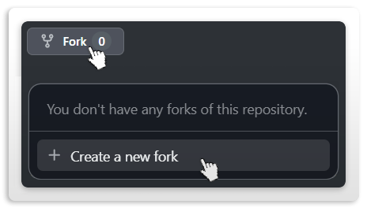

# Contributing to gitagger

Thanks for contributing. Follow the guidelines below and submit a PR when your changes are ready.

## Getting started

### 1. Clone and branch

Fork the project from [GitHub](https://github.com/CHE3MZ/gitagger/fork),



   ```sh
   git clone https://github.com/YOUR_USERNAME/gitagger.git
   cd gitagger
   git switch -c feat-short-description
   ```
   Name the branch after the work (`feat-rm-alias`, `fix-doctor-offline`). It makes the commit list readable later.

### 2. Make your change

Keep it scoped: one thing per branch. Match the existing code style (strict flags, explicit errors, no magic), and add tests in `tests/` for anything new if possible. All tests use throwaway temp repos and the git on your `PATH`; they never touch the repo's own `.git`.

### 3. Check locally first

The `scripts/` folder is the local gate. Run these before you push:
   ```sh
   sh scripts/test.sh              # vet + full test suite (~1 min)
   sh scripts/ops/go-bugcheck.sh   # golangci-lint, govulncheck, staticcheck, errcheck, vet, test
   sh scripts/ops/go-seccheck.sh   # gosec
   ```
   Then build for every release platform:
   ```sh
   sh scripts/build.sh
   ```
   > [!NOTE]
   > `gopls` gets skipped by `go-bugcheck.sh` on some shells because plain `sh` has no `mapfile`; CI runs it for real. Never cut tags or releases yourself; the maintainer handles all of that.

### 4. Push and watch CI go green

Push the branch, then confirm every workflow is green before opening the PR:
   ```sh
   git push origin feat-short-description
   gh run watch
   ```
   That covers CI (build, vet, test, ops lint, actionlint), the action self-test, the cross-platform build matrix, and the Docker job. If something's red, fix it on the branch and push again. If the errors were not caused by your changes, document that in your PR description.

### 5. Open the PR

Use a conventional title, the same style as the commit history:
   `feat:`, `fix:`, `tweak:`, `chore:`, `docs:`, `test:`, `refactor:`. Keep it short and specific, for example `feat: rm shorthand for remove`, not `feat: updates`.
   ```sh
   gh pr create --title "feat: rm shorthand for remove" --body "What it does and why."
   ```
   A maintainer will review it. Expect comments and don't take them personally: small focused PRs get merged fast, and big sprawling ones get asked to split.

## Ground rules

- All workflows must be green before a PR is merged.
- Conventional commit messages (`git log --oneline` shows the style).
- No tags, no releases, no force-pushes to `master`.
- One concern per PR. If you spot something else broken along the way, branch it separately.


