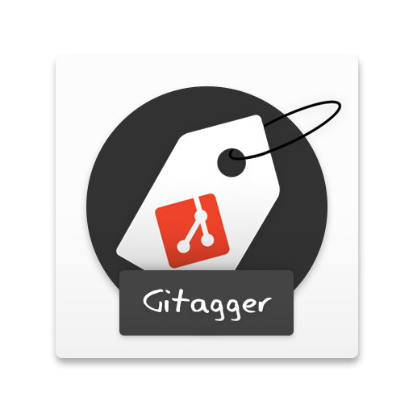
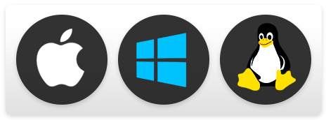
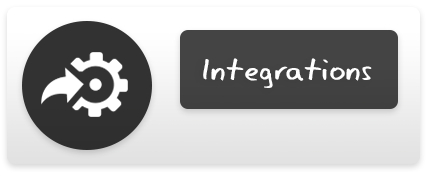
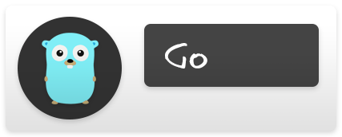
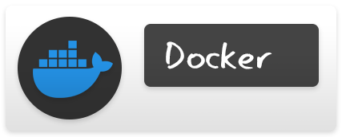
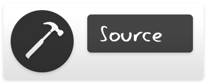
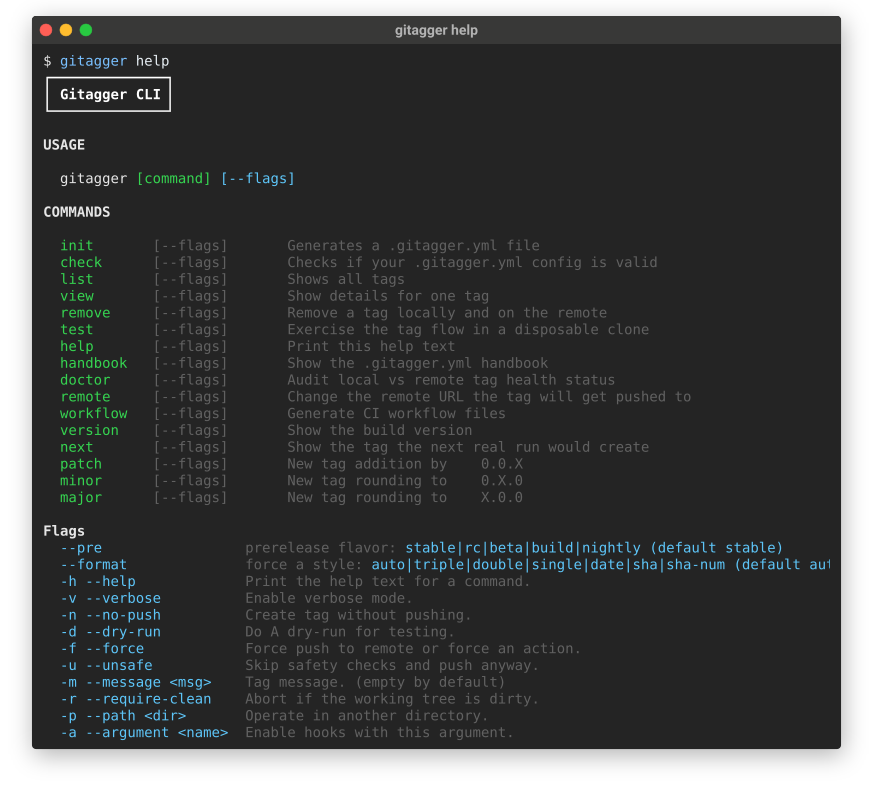
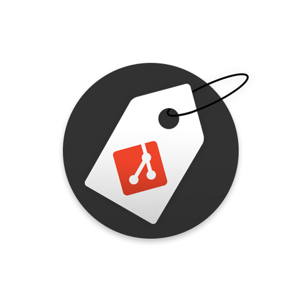

# Gitagger

[](https://github.com/CHE3MZ/gitagger/actions/workflows/ci.yml)
[](https://github.com/CHE3MZ/gitagger/releases/latest)
[](https://github.com/CHE3MZ/gitagger/actions/workflows/container.yml)

### Gitagger makes tag creation for git projects *ridiculously* <u> simple and easy! </u>

Just [Install](#installation) it and run `gitagger` and it will integrate with your existing tag format or initialize one for you.


### Full documentation [**here!**](https://che3mz.github.io/gitagger/)

## Features

### ➙ Cross Platform


Gitagger is available on Windows, MacOS and Linux!

### ➙ Hooks


You can make gitagger run basic hooks via the .gitagger.yml file! you can check out this projects own config and usage of hooks [here!](.gitagger.yml)

### ➙ Integrations


Gitagger has integrations for Docker and containers in general!

## Installation

### ➙ Install with Go 



Requires [Go 1.27](https://go.dev/dl/) or newer:

```sh
go install github.com/CHE3MZ/gitagger/cmd/gitagger@latest
```

### ➙ Prebuilt binaries


You can also download a binary from the [releases page](https://github.com/CHE3MZ/gitagger/releases) for Linux, macOS, or Windows.

### ➙ Docker



```sh
docker pull ghcr.io/che3mz/gitagger:latest
```

[](https://github.com/che3mz/gitagger/pkgs/container/gitagger/)

### ➙ Compile from source



#### Requires [Go 1.27](https://go.dev/dl/) or newer:

```sh
git clone https://github.com/CHE3MZ/gitagger.git
cd gitagger
go build -o gitagger ./cmd/gitagger
```

#### Building the Container Image:

```sh
docker build -t gitagger .
docker run --rm -v "$PWD:/repo" -w /repo gitagger [args]
```

## Usage



```sh
gitagger
gitagger minor
gitagger --help
```

Run `gitagger init` once to write `.gitagger.yml`, edit it, then run plain `gitagger` without flags.

### Full documentation [**here!**](https://che3mz.github.io/gitagger/)

## Contributing

See the **[contribution guide](.github/CONTRIBUTING.md).**

## License

Gitagger is licensed under the **[Apache 2.0 License](LICENSE).**


