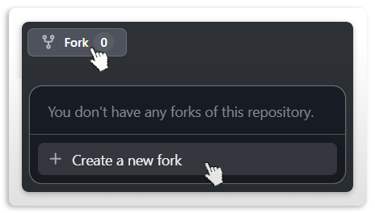

# Contributing

Short version: small branches, green CI, conventional titles, human review. The full process (local gates, what to run before pushing, ground rules) is in [`CONTRIBUTING.md`](https://github.com/CHE3MZ/gitagger/blob/master/.github/CONTRIBUTING.md) in the repo.

**Make sure every workflow is green before opening the PR** (`gh run watch`), and never cut tags or releases: the maintainer handles all of that.
