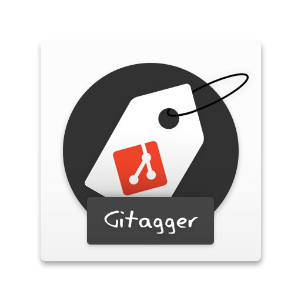

# Gitagger

Run `gitagger` and it detects your tag format, creates the next tag, and pushes it. On a repo with no tags, it creates `v1.0.0`.

```sh
gitagger                 # next patch tag, pushed if it can be
gitagger minor           # v1.2.3 -> v1.3.0
gitagger major --pre rc  # v1.2.3 -> v2.0.0-rc
gitagger --dry-run       # show the plan, change nothing
```

## What it does

Triple (`v1.2.3`), double (`v1.2`), single (`v7`), date (`v2026.10.04`), and `master-<sha>` formats are detected from history by majority vote, so most repos need no flags. Before writing, gitagger refuses to double-tag HEAD, can check the remote for collisions with `doctor`, keeps the tag local when offline, and only force-pushes with `-f`.

Hooks run shell commands at `start`, `success`, `failure`, and `finish` for releases, notifications, or other steps. The binary has no runtime dependencies and runs on Linux, macOS, Windows, Docker, and GitHub Actions.

## Start here

- [Install gitagger](getting-started/installation.md), then [cut your first tag](getting-started/first-tag.md).
- [Commands](usage/commands.md) is the full CLI reference.
- Automation: [GitHub Action](automation/github-action.md), [generated workflows](automation/workflows.md), or [Docker](automation/docker.md).
- Troubleshooting: [FAQ](help/faq.md).


## License

gitagger is licensed under the [Apache License 2.0](legal/LICENSE.md).
